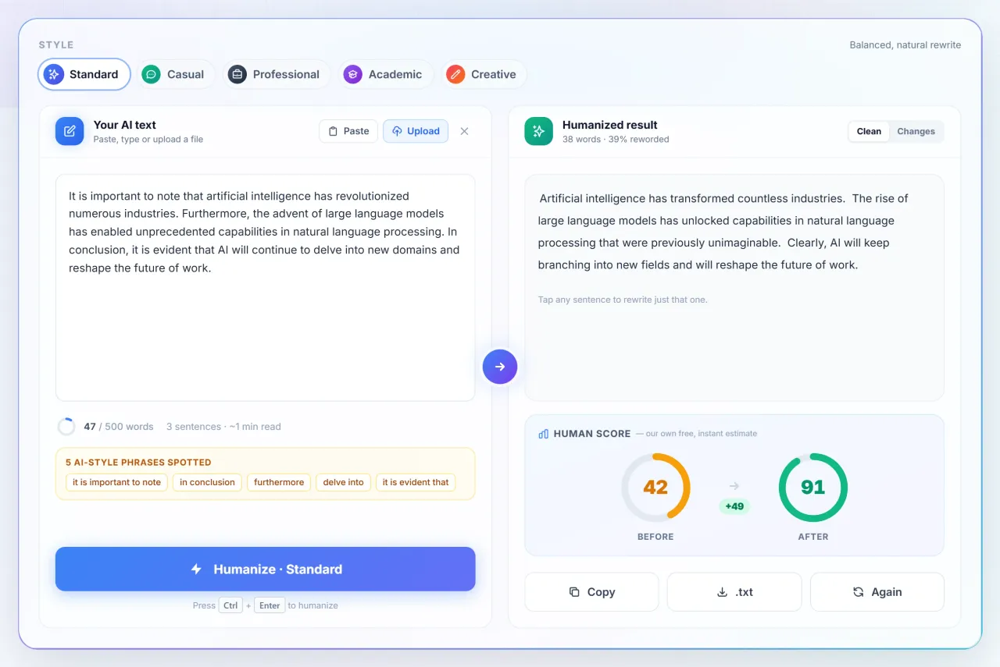

# Text Humanizer

[**texthumanizer.site**](https://texthumanizer.site) is a free web app for editing AI-written drafts so they read naturally. It bundles four tools: an **AI humanizer**, a **grammar checker**, an **AI content detector** and a **plagiarism checker**.

[Live site](https://texthumanizer.site) · [Guide page](https://mani-django09.github.io/texthumanizer/) · [Blog](https://texthumanizer.site/blog) · [Pricing](https://texthumanizer.site/pricing)



## Features

| Tool | What it does |
| --- | --- |
| [AI Humanizer](https://texthumanizer.site/ai-humanizer) | Rewrites AI-sounding text in a chosen style, shows a Changes view, lets you re-roll a single sentence, and reports a Human Score estimate |
| [Grammar Checker](https://texthumanizer.site/grammar-checker) | Lists spelling, grammar and punctuation corrections with the corrected text |
| [AI Content Detector](https://texthumanizer.site/ai-detector) | Style-based AI-likeness score with sentence-level highlights |
| [Plagiarism Checker](https://texthumanizer.site/plagiarism-checker) | Searches the live web for each sampled sentence and only reports a match when the result really shares a run of words |

Also: accounts with Google sign-in, upload of `.txt`, `.docx` and `.pdf` files, usage history, referral and affiliate pages, an admin panel, and paid plans through LemonSqueezy.

> **Heads-up:** the Human Score and the AI Content Detector are this project's own heuristics (`backend/humanScore.js`). They are not predictions of what any third-party detector will say.

## Tech stack

- **Frontend:** Next.js 14 (App Router), React 18, Tailwind CSS
- **Backend:** Node.js, Express, PostgreSQL
- **AI providers:** tried in order Gemini → Groq → OpenAI, so one outage does not take the tool down
- **Billing:** LemonSqueezy checkout and signed webhooks (idempotent via a `webhook_events` table)
- **Email:** Resend (password reset, contact form)
- **Web search for plagiarism:** Serper, Tavily or Brave (first configured key wins)
- **Ops:** PM2, Nginx, Let's Encrypt

## Repository layout

```
frontend/   Next.js app (pages in app/, UI in components/, copy and limits in lib/)
backend/    Express API (server.js, routes/, migrations/, plans.js, entitlements.js)
docs/       Static guide page published with GitHub Pages
```

## Plans and limits

Defined once in [`backend/plans.js`](backend/plans.js), enforced server-side in [`backend/entitlements.js`](backend/entitlements.js).

| Plan | Words per request | Words per month |
| --- | --- | --- |
| Guest | 500 | 5,000 |
| Free account | 500 | 5,000 (+ referral bonus) |
| Basic | 2,000 | 15,000 |
| Pro | no cap | 50,000 |
| Unlimited | no cap | no cap |

Guests are metered by a salted SHA-256 hash of their IP, so raw addresses are not stored.

## Run locally

Requires Node 18+ and PostgreSQL.

```bash
# 1. database: create it, then apply the SQL files in order
createdb texthumanizer
for f in backend/migrations/*.sql; do psql texthumanizer -f "$f"; done

# 2. backend (http://localhost:5050)
cd backend
cp .env.example .env        # fill in at least one AI key and the DB settings
npm install
node server.js

# 3. frontend (http://localhost:3000)
cd ../frontend
cp .env.example .env.local
npm install
npm run dev
```

`000_base_schema.sql` holds the core tables (users, history, activity logs, affiliate applications, password reset tokens); the later files add billing, guest usage and contact messages. Apply `000` first, then the rest in order; `001`-`003` are safe to re-run.

## Configuration

All settings are environment variables; see [`backend/.env.example`](backend/.env.example) and [`frontend/.env.example`](frontend/.env.example). Real `.env` files are git-ignored.

| Variable | Used for |
| --- | --- |
| `GEMINI_API_KEY`, `GROQ_API_KEY`, `OPENAI_API_KEY` | AI rewriting (set at least one) |
| `JWT_SECRET`, `GOOGLE_CLIENT_ID` | Sessions and Google sign-in |
| `DB_HOST`, `DB_PORT`, `DB_USER`, `DB_PASSWORD`, `DB_NAME` | PostgreSQL |
| `SERPER_API_KEY` / `TAVILY_API_KEY` / `BRAVE_SEARCH_API_KEY` | Plagiarism web search |
| `RESEND_API_KEY`, `EMAIL_FROM`, `CONTACT_TO` | Transactional email (console fallback if unset) |
| `LS_*` | LemonSqueezy API key, store, webhook secret and variant IDs |
| `NEXT_PUBLIC_GA_MEASUREMENT_ID`, `NEXT_PUBLIC_GSC_VERIFICATION` | Analytics and Search Console |

## API

All endpoints are under `/api` and rate limited.

| Method | Path | Purpose |
| --- | --- | --- |
| POST | `/humanize` | Rewrite text in a style |
| POST | `/humanize/regenerate-sentence` | Re-roll one sentence |
| POST | `/grammar-check` | Grammar corrections |
| POST | `/ai-detect` | Style-based AI score |
| POST | `/plagiarism-check` | Web match scan |
| POST | `/extract-text` | Text from `.txt`, `.docx`, `.pdf` |
| `*` | `/auth`, `/history`, `/referral`, `/affiliate`, `/admin` | Accounts and dashboards |
| `*` | `/billing/*` | Checkout, customer portal, webhook |
| POST | `/contact` | Contact form |

## Deployment

Production runs on a VPS behind Nginx with two PM2 processes. Deploys pull from this repository:

```bash
ssh <server> deploy-texthumanizer          # pull main, rebuild what changed, restart, health check
ssh <server> deploy-texthumanizer --force  # rebuild and restart everything
```

New SQL migrations are not applied automatically; run them with `psql` before deploying code that needs them.

## Contributing

Issues and pull requests are welcome. Please keep claims in the UI honest (no invented statistics or detector guarantees) and run `npm run build` in `frontend/` before opening a PR.

## License

No license has been chosen yet, so all rights are reserved by default. Open an issue if you would like to reuse part of the code.
